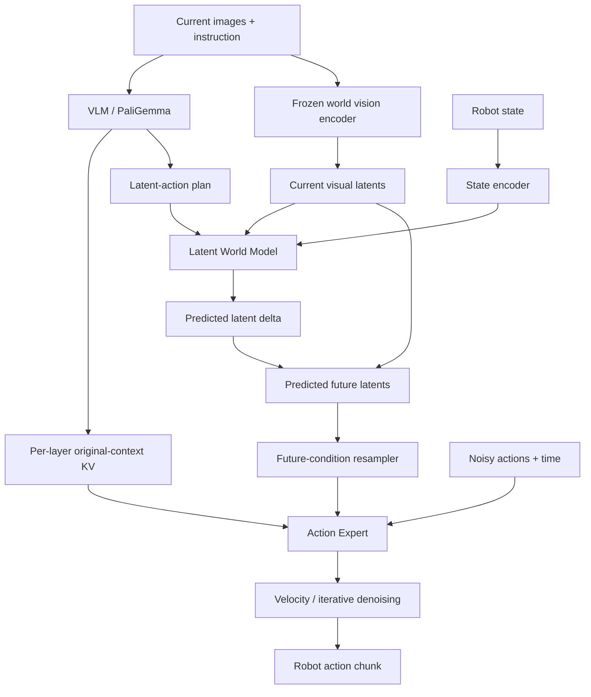

# WAVE-0 World Model Expert

**Modular source connecting scene understanding, action-conditioned future prediction, and robot action generation.**

This project separates a local WAVE-0 / π0.6 implementation into responsibility-specific modules for reading, research, and modification. It shows how a world model conditions a vision-language-action policy: the VLM proposes latent actions, the world model predicts future visual features, and the Action Expert generates an action chunk using both current context and predicted futures.

## What does it explain?

- **Where do actions come from?** Images, instructions, and state feed the policy; the Expert predicts flow velocities and iteratively denoises a continuous action chunk.
- **What does the world model predict?** A visual-latent delta, added to current latents to obtain predicted future latents; this implementation has no RGB-video decoder.
- **Where is it inserted?** Between the VLM's latent-action plan and the Expert's future-condition inputs, alongside a direct path carrying original VLM context K/V to the Expert.
- **How does Expert Q read VLM K/V?** Matching-layer VLM context K/V are concatenated with Expert future/action K/V along the token axis, then read through masked attention using Expert queries.

## Architecture



The world model is a future-conditioning branch before the Expert, rather than an extra VLM layer or a scorer after action generation. The Expert also retains direct access to current vision-language information through context K/V.

See [architecture and data flow](docs/ARCHITECTURE.md) and the [source reading guide](docs/READING_GUIDE.md).

## Core attention

At a Transformer layer:

```text
Q = [Q_future ; Q_action]
K = [K_vlm_context ; K_future ; K_action]
V = [V_vlm_context ; V_future ; V_action]

output = softmax(scale * Q @ K.transpose(-2, -1) + mask) @ V
```

`;` denotes token-axis concatenation. Action queries see valid context, future-condition, and action tokens; future queries see context and future tokens. All visible regions share one softmax. The low-level helper handles GQA head expansion and attention computation.

**Start at `compute_expert_layer_with_context_kv` in [`attention.py`](attention.py).** The same file contains per-layer VLM KV production in `compute_vlm_layer_with_context_kv`; [`vlm_expert.py`](vlm_expert.py) orchestrates the layer loops.

## Two training stages

| Stage | Inputs and objective | Training boundary |
|---|---|---|
| Stage 1: Learn dynamics | Current visual features, state, ground-truth actions → future visual features | Freeze vision; train action/state encoders and dynamics |
| Stage 2: Learn the policy | VLM latent actions → frozen world model → future conditions; Expert learns action flow | Freeze Stage-1 world modules; configuration controls policy trainability |

In Stage 2, the ground-truth action encoder supplies latent-action teacher targets; ground-truth actions are not directly used as the world-prediction branch's action input. Ground-truth future images supervise training and are unavailable at inference.

Freezing world-model parameters does not imply wrapping the prediction in `no_grad()`: future-prediction losses still differentiate through it into VLM-produced latent actions. The default `wam_detach_future_condition=True` cuts the predicted-future-to-flow-conditioning gradient path; the context-KV path remains differentiable.

## Modules

| File | Responsibility |
|---|---|
| [`attention.py`](attention.py) | Layerwise Q/K/V, RoPE, concatenated attention and residuals |
| [`vlm_expert.py`](vlm_expert.py) | VLM/Expert composition and per-layer KV orchestration |
| [`world_model.py`](world_model.py) | World vision, action/state encoders, latent dynamics and future resampling |
| [`stage1_model.py`](stage1_model.py) | Compact Stage-1 model |
| [`model.py`](model.py) | π0.5 initialization and module composition |
| [`model_tokens.py`](model_tokens.py) | Context, planner and action token construction; KV extraction |
| [`model_training.py`](model_training.py) | Flow matching, Expert conditioning and masking |
| [`model_inference.py`](model_inference.py) | Cache preparation, future prefill and iterative denoising |
| [`policy.py`](policy.py) | Policy entry points, stage dispatch and freeze boundaries |
| [`policy_training.py`](policy_training.py) | Stage-1/2 losses, teacher alignment and validity reduction |
| [`policy_data.py`](policy_data.py) | Image processing, actions and future-supervision windows |
| [`policy_checkpoint.py`](policy_checkpoint.py) | Checkpoint resolution, weight injection and compatibility |
| [`policy_inference.py`](policy_inference.py) | Action queues, RTC and policy-level inference |
| [`tensor_utils.py`](tensor_utils.py) | Masks, time embeddings, image resizing and tensor utilities |
| [`configuration_wave0.py`](configuration_wave0.py) | Included WAVE-0 configuration |
| [`rtc_training.py`](rtc_training.py) | Included RTC-prefix and training utilities |
| [`_runtime.py`](_runtime.py) | Original-project and third-party dependency boundary |
| [`__init__.py`](__init__.py) | Public model and policy exports |

## Using this source

Modules use explicit relative imports. Responsibility-specific mixins share state on the assembled model instance and are not standalone models. This directory does not automatically replace imports in the original training project.

Execution requires compatible LeRobot base components, a base policy, and the matching PyTorch / Transformers environment. WAVE-0 configuration and RTC training utilities are included; policy bases and general LeRobot configuration still come from external dependencies. The code uses modified Transformers interfaces such as adaptive normalization; generic package installations are not guaranteed to be compatible. `model.py` checks that the required modification is installed.

Use an isolated Python environment and prepare a suitable PyTorch / CUDA combination for the target machine. The following commands show installation order, not a locked, end-to-end-validated reproduction environment.

First obtain upstream WAVE-0 and install its LeRobot components with the π-family extras:

```bash
git clone https://github.com/AutoLab-SAI-SJTU/WAVE-0.git wave0-base
cd wave0-base
python -m pip install -e ".[pi]"
```

Compatibility between the current upstream revision and this extracted implementation has not been verified. The command does not pin the upstream revision and does not reconstruct the original training environment exactly. [`requirements-runtime.txt`](requirements-runtime.txt) records the Transformers commit checked against the local base project's dependency declaration: `dcddb970176382c0fcf4521b0c0e6fc15894dfe0`. Checking that declaration does not validate execution of the dependency combination.

Then enter this repository's root and install the module package. The example assumes sibling repositories and a local directory named `wave0-world-model-expert`; adjust the `cd` path if needed.

```bash
cd ../wave0-world-model-expert
python -m pip install -e . --no-deps
```

`--no-deps` neither installs missing dependencies nor replaces the environment prepared above. Model construction and weight loading additionally require compatible base-policy weights, a Stage-1 world-model checkpoint, and valid configuration.

The public interfaces can then be imported:

```python
from wave0_decoupled import PI05Pytorch, WAVE0Policy, WAVE0Stage1Model
```

This repository does not contain model weights, training data, a complete distributed job setup, or robot deployment configuration. Its main deliverable is readable model source and architecture documentation; it does not claim independently reproduced paper results or validated cloud training.

## Branches

| Branch | Purpose |
|---|---|
| `main` | Integrated source and project documentation |
| `docs/architecture` | Architecture and world-model integration study |
| `study/attention` | Expert Q, VLM KV and attention-mask study |

The three branches initially point to the same release snapshot as entry points for subsequent study and changes; they do not represent different models or trained weights.

## Provenance and validation

The source was extracted from the local WAVE-0 `src/lerobot/policies/wave0/modeling_wave0.py`, retaining existing copyright notices. The upstream project is [AutoLab-SAI-SJTU/WAVE-0](https://github.com/AutoLab-SAI-SJTU/WAVE-0). This repository contains a local implementation and its modular organization; local changes should not all be attributed to the official paper release, and parity with an active cloud job has not been verified.

Extraction checks included executable-AST comparison of original functions/methods, compilation, and local import-cycle analysis. Consult [`validation.json`](validation.json) and repository verification records for the final publication checks; static equivalence does not replace execution in the real dependency environment or GPU numerical-equivalence validation.
