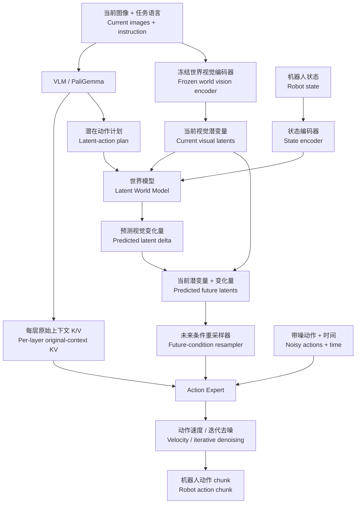

# WAVE-0 World Model Expert

**把“理解当前场景、预测动作后果、生成机器人动作”串起来的模块化源码。**

**Modular source connecting scene understanding, action-conditioned future prediction, and robot action generation.**

这个项目把本地 WAVE-0 / π0.5 实现中的大模型文件按职责拆开，方便逐层阅读、研究和修改。它重点展示一个世界模型如何接入视觉语言动作策略：VLM 先提出潜在动作计划，世界模型预测执行计划后的未来视觉特征，Action Expert 再结合当前上下文和预测未来生成动作 chunk。

This project separates a local WAVE-0 / π0.5 implementation into responsibility-specific modules for reading, research, and modification. It shows how a world model conditions a vision-language-action policy: the VLM proposes latent actions, the world model predicts future visual features, and the Action Expert generates an action chunk using both current context and predicted futures.

## 项目能帮助你理解什么？ / What does it explain?

- **动作从哪里来？** 图像、任务语言与状态构成策略输入；Expert 通过 flow matching 预测动作速度并迭代去噪，得到一段连续动作。
  **Where do actions come from?** Images, instructions, and state feed the policy; the Expert predicts flow velocities and iteratively denoises a continuous action chunk.
- **世界模型预测什么？** 预测视觉潜变量的变化量，再与当前视觉潜变量相加得到预测未来；这里没有 RGB 视频解码器。
  **What does the world model predict?** A visual-latent delta, added to current latents to obtain predicted future latents; this implementation has no RGB-video decoder.
- **世界模型加在哪里？** 加在 VLM 的潜在动作规划输出与 Expert 的未来条件输入之间；VLM 原始上下文 K/V 还通过另一条直接路径供 Expert 使用。
  **Where is it inserted?** Between the VLM's latent-action plan and the Expert's future-condition inputs, alongside a direct path carrying original VLM context K/V to the Expert.
- **Expert Q 怎样读取 VLM K/V？** 对应层的 VLM 上下文 K/V 与 Expert 的未来、动作 K/V 沿 token 维拼接，再由 Expert Q 做带掩码注意力。
  **How does Expert Q read VLM K/V?** Matching-layer VLM context K/V are concatenated with Expert future/action K/V along the token axis, then read through masked attention using Expert queries.

## 整体架构 / Architecture



图中的“世界模型”不是 VLM 内部新增的一层，也不是 Expert 后面的评分器。它是 Expert 之前的一条预测未来条件支路。Expert 同时保留访问当前视觉语言信息的直接 K/V 路径。

The world model is a future-conditioning branch before the Expert, rather than an extra VLM layer or a scorer after action generation. The Expert also retains direct access to current vision-language information through context K/V.

完整说明见 [架构与数据流](docs/ARCHITECTURE.md)，源码阅读路线见 [阅读指南](docs/READING_GUIDE.md)。

See [architecture and data flow](docs/ARCHITECTURE.md) and the [source reading guide](docs/READING_GUIDE.md).

## 核心注意力 / Core attention

在某一个 Transformer 层，计算关系为：

At a Transformer layer:

```text
Q = [Q_future ; Q_action]
K = [K_vlm_context ; K_future ; K_action]
V = [V_vlm_context ; V_future ; V_action]

output = softmax(scale * Q @ K.transpose(-2, -1) + mask) @ V
```

`;` 表示沿 token 维拼接。动作 Q 可以关注有效的上下文、未来条件和动作 token；未来 Q 只看上下文和未来条件。三个区域共享一次 softmax。底层 helper 负责 GQA 的头数对齐和注意力计算。

`;` denotes token-axis concatenation. Action queries see valid context, future-condition, and action tokens; future queries see context and future tokens. All visible regions share one softmax. The low-level helper handles GQA head expansion and attention computation.

**直接看 [`attention.py`](attention.py) 的 `compute_expert_layer_with_context_kv`。** VLM 的逐层 K/V 来源在同文件的 `compute_vlm_layer_with_context_kv`；按层调度在 [`vlm_expert.py`](vlm_expert.py)。

**Start at `compute_expert_layer_with_context_kv` in [`attention.py`](attention.py).** The same file contains per-layer VLM KV production in `compute_vlm_layer_with_context_kv`; [`vlm_expert.py`](vlm_expert.py) orchestrates the layer loops.

## 两个训练阶段 / Two training stages

| 阶段 / Stage | 输入与目标 / Inputs and objective | 训练边界 / Training boundary |
|---|---|---|
| Stage 1：学习动力学 / Learn dynamics | 当前视觉特征、状态、真实动作 → 未来视觉特征 / Current visual features, state, ground-truth actions → future visual features | 冻结视觉骨干；训练动作编码器、状态编码器与世界模型 / Freeze vision; train action/state encoders and dynamics |
| Stage 2：学习策略 / Learn the policy | VLM 预测潜在动作 → 冻结世界模型 → 未来条件；Expert 学习动作 flow / VLM latent actions → frozen world model → future conditions; Expert learns action flow | 冻结第一阶段世界模块；策略的可训练部分由配置控制 / Freeze Stage-1 world modules; configuration controls policy trainability |

Stage 2 的真实动作编码器提供潜在动作教师目标；真实动作本身不直接作为该阶段世界预测分支的动作输入。未来真实图像用于训练监督，不是推理时可用的输入。

In Stage 2, the ground-truth action encoder supplies latent-action teacher targets; ground-truth actions are not directly used as the world-prediction branch's action input. Ground-truth future images supervise training and are unavailable at inference.

冻结世界模型参数不等于把它放进 `no_grad()`：未来预测损失仍需穿过世界模型，对 VLM 提出的潜在动作求导。默认的 `wam_detach_future_condition=True` 只切开预测未来到动作 flow 条件输入的梯度路径；上下文 K/V 路径仍可微。

Freezing world-model parameters does not imply wrapping the prediction in `no_grad()`: future-prediction losses still differentiate through it into VLM-produced latent actions. The default `wam_detach_future_condition=True` cuts the predicted-future-to-flow-conditioning gradient path; the context-KV path remains differentiable.

## 文件职责 / Modules

| 文件 / File | 职责 / Responsibility |
|---|---|
| [`attention.py`](attention.py) | 逐层 Q/K/V、RoPE、拼接注意力与残差 / Layerwise Q/K/V, RoPE, concatenated attention and residuals |
| [`vlm_expert.py`](vlm_expert.py) | VLM 与 Expert 组装、逐层 KV 生产和消费 / VLM/Expert composition and per-layer KV orchestration |
| [`world_model.py`](world_model.py) | 世界视觉骨干、动作/状态编码器、潜在动力学和未来重采样 / World vision, action/state encoders, latent dynamics and future resampling |
| [`stage1_model.py`](stage1_model.py) | 精简第一阶段模型 / Compact Stage-1 model |
| [`model.py`](model.py) | π0.5 模型初始化与模块组合 / π0.5 initialization and module composition |
| [`model_tokens.py`](model_tokens.py) | 上下文、规划查询、动作 token 与 KV 提取 / Context, planner and action token construction; KV extraction |
| [`model_training.py`](model_training.py) | flow matching、Expert 条件与掩码 / Flow matching, Expert conditioning and masking |
| [`model_inference.py`](model_inference.py) | 缓存准备、未来条件预填与迭代去噪 / Cache preparation, future prefill and iterative denoising |
| [`policy.py`](policy.py) | 策略入口、阶段调度和冻结边界 / Policy entry points, stage dispatch and freeze boundaries |
| [`policy_training.py`](policy_training.py) | Stage 1/2 损失、教师对齐、有效样本统计 / Stage-1/2 losses, teacher alignment and validity reduction |
| [`policy_data.py`](policy_data.py) | 图像预处理、动作与未来监督窗口 / Image processing, actions and future-supervision windows |
| [`policy_checkpoint.py`](policy_checkpoint.py) | 检查点解析、权重注入与兼容 / Checkpoint resolution, weight injection and compatibility |
| [`policy_inference.py`](policy_inference.py) | 动作队列、RTC 与策略级推理 / Action queues, RTC and policy-level inference |
| [`tensor_utils.py`](tensor_utils.py) | 掩码、时间嵌入、图像缩放与张量工具 / Masks, time embeddings, image resizing and tensor utilities |
| [`configuration_wave0.py`](configuration_wave0.py) | 随仓库提供的 WAVE-0 配置 / Included WAVE-0 configuration |
| [`rtc_training.py`](rtc_training.py) | 随仓库提供的 RTC 前缀与训练辅助 / Included RTC-prefix and training utilities |
| [`_runtime.py`](_runtime.py) | 原项目与第三方依赖入口 / Original-project and third-party dependency boundary |
| [`__init__.py`](__init__.py) | 导出 `WAVE0Policy`、`PI05Pytorch` 和 `WAVE0Stage1Model` / Public model and policy exports |

## 如何使用这份源码 / Using this source

源码按显式相对导入连接，大类通过 mixin 按职责组合。mixin 共享最终模型实例上的 `self` 状态，不是可单独实例化的模型。拆分目录不会自动替换原训练工程中的导入。

Modules use explicit relative imports. Responsibility-specific mixins share state on the assembled model instance and are not standalone models. This directory does not automatically replace imports in the original training project.

运行需要与原本地 WAVE-0 版本兼容的 LeRobot 基础组件、基础策略，以及对应的 PyTorch / Transformers 环境。WAVE-0 配置和 RTC 训练辅助文件随本仓库提供；策略基类、通用 LeRobot 配置等仍来自外部依赖。源码使用自适应归一化等修改版 Transformers 接口；普通的同名依赖包不保证兼容。`model.py` 会检查该修改是否安装正确。

Execution requires compatible LeRobot base components, a base policy, and the matching PyTorch / Transformers environment. WAVE-0 configuration and RTC training utilities are included; policy bases and general LeRobot configuration still come from external dependencies. The code uses modified Transformers interfaces such as adaptive normalization; generic package installations are not guaranteed to be compatible. `model.py` checks that the required modification is installed.

建议先创建独立 Python 环境，并按目标机器准备合适的 PyTorch / CUDA 组合。下面展示依赖安装顺序；它不是已锁定、已端到端验证的复现环境。

Use an isolated Python environment and prepare a suitable PyTorch / CUDA combination for the target machine. The following commands show installation order, not a locked, end-to-end-validated reproduction environment.

先取得上游 WAVE-0，安装 LeRobot 基础组件及其 π 系列额外依赖：

First obtain upstream WAVE-0 and install its LeRobot components with the π-family extras:

```bash
git clone https://github.com/AutoLab-SAI-SJTU/WAVE-0.git wave0-base
cd wave0-base
python -m pip install -e ".[pi]"
```

上游当前版本与本地拆分实现的兼容性尚未验证；该命令不固定上游提交，不能视为原训练环境的精确重建。本仓库的 [`requirements-runtime.txt`](requirements-runtime.txt) 记录了在本地原项目依赖声明中核对的 Transformers 提交 `dcddb970176382c0fcf4521b0c0e6fc15894dfe0`。核对依赖声明不等于完成该组合的运行验证。

Compatibility between the current upstream revision and this extracted implementation has not been verified. The command does not pin the upstream revision and does not reconstruct the original training environment exactly. [`requirements-runtime.txt`](requirements-runtime.txt) records the Transformers commit checked against the local base project's dependency declaration: `dcddb970176382c0fcf4521b0c0e6fc15894dfe0`. Checking that declaration does not validate execution of the dependency combination.

再切换到本仓库根目录，安装模块包。下面假定两个仓库位于同一个父目录，且本仓库目录名为 `wave0-world-model-expert`；目录名不同时调整 `cd` 路径。

Then enter this repository's root and install the module package. The example assumes sibling repositories and a local directory named `wave0-world-model-expert`; adjust the `cd` path if needed.

```bash
cd ../wave0-world-model-expert
python -m pip install -e . --no-deps
```

`--no-deps` 不会安装缺失依赖，也不会替换前一步准备的运行环境。模型构造和权重加载还需要兼容的基础策略权重、第一阶段世界模型检查点以及有效配置。

`--no-deps` neither installs missing dependencies nor replaces the environment prepared above. Model construction and weight loading additionally require compatible base-policy weights, a Stage-1 world-model checkpoint, and valid configuration.

随后可以导入对外接口：

The public interfaces can then be imported:

```python
from wave0_decoupled import PI05Pytorch, WAVE0Policy, WAVE0Stage1Model
```

仓库不包含模型权重、训练数据、完整分布式作业配置或机器人部署配置。这里的主要交付是可阅读、可继续开发的模型实现与架构说明；它不宣称已独立复现论文指标或完成云端训练验证。

This repository does not contain model weights, training data, a complete distributed job setup, or robot deployment configuration. Its main deliverable is readable model source and architecture documentation; it does not claim independently reproduced paper results or validated cloud training.

## 分支用途 / Branches

| 分支 / Branch | 用途 / Purpose |
|---|---|
| `main` | 集成后的源码和项目介绍 / Integrated source and project documentation |
| `docs/architecture` | 架构与世界模型接入位置的学习入口 / Architecture and world-model integration study |
| `study/attention` | Expert Q、VLM KV 与掩码机制的学习入口 / Expert Q, VLM KV and attention-mask study |

三个分支最初指向同一份发布快照，用于建立后续学习和修改的入口，不代表三套不同模型或不同训练权重。

The three branches initially point to the same release snapshot as entry points for subsequent study and changes; they do not represent different models or trained weights.

## 来源与验证 / Provenance and validation

源码源自本地 WAVE-0 实现中 `src/lerobot/policies/wave0/modeling_wave0.py` 的拆分，保留原有版权声明。上游项目为 [AutoLab-SAI-SJTU/WAVE-0](https://github.com/AutoLab-SAI-SJTU/WAVE-0)。本仓库包含本地实现及其拆分整理，不能据此把所有本地修改视为论文官方原版，也没有验证与云端当前作业的逐字一致性。

The source was extracted from the local WAVE-0 `src/lerobot/policies/wave0/modeling_wave0.py`, retaining existing copyright notices. The upstream project is [AutoLab-SAI-SJTU/WAVE-0](https://github.com/AutoLab-SAI-SJTU/WAVE-0). This repository contains a local implementation and its modular organization; local changes should not all be attributed to the official paper release, and parity with an active cloud job has not been verified.

拆分时已检查原函数/方法的可执行语法树、模块编译和循环导入。最终发布时的实际检查以 [`validation.json`](validation.json) 与仓库验证记录为准；静态一致性不能代替真实依赖环境中的运行或 GPU 数值等价验证。

Extraction checks included executable-AST comparison of original functions/methods, compilation, and local import-cycle analysis. Consult [`validation.json`](validation.json) and repository verification records for the final publication checks; static equivalence does not replace execution in the real dependency environment or GPU numerical-equivalence validation.
