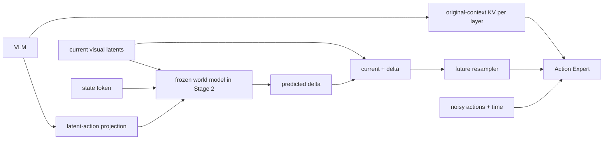

# 架构与数据流 / Architecture and data flow

## 1. 项目的任务 / Task

项目实现一种世界模型条件化的视觉语言动作策略：输入当前相机图像、任务语言和机器人状态，输出连续动作 chunk。π0.5 / PaliGemma 提供视觉语言理解与 Action Expert 基础；新增规划查询、潜在世界模型与未来条件重采样器，使动作生成能读取一个由动作计划预测出的未来视觉状态。

The implementation is a world-model-conditioned vision-language-action policy: current images, task language, and robot state lead to a continuous action chunk. π0.5 / PaliGemma provides the VLM and Action Expert foundation; planner queries, latent dynamics, and future-condition resampling let action generation read a future visual state predicted from a proposed plan.

未来状态位于视觉特征空间。当前实现没有 RGB 解码器，没有显式的多候选动作搜索循环，也不应把潜在动作规划 token 直接当作最终关节指令。

The predicted future lives in visual-feature space. This implementation has no RGB decoder or explicit multi-candidate action-search loop; latent-action planning tokens are not final joint commands.

## 2. 世界模型接入位置 / World-model insertion point



这里有两条互补路径：

There are two complementary paths:

1. **当前上下文路径：** VLM 每层的原始图像/语言上下文 K/V 直接送给对应层 Expert，保留对当前场景和任务的访问。
   **Current-context path:** Original image/language context K/V from each VLM layer goes directly to the corresponding Expert layer, preserving scene and instruction access.
2. **预测未来路径：** VLM 潜在动作 → 世界模型 → 预测未来视觉潜变量 → 重采样器 → Expert 未来 token，提供计划后果条件。
   **Predicted-future path:** VLM latent actions → world model → predicted future visual latents → resampler → Expert future tokens, providing action-consequence conditioning.

因此，“VLM → World Model → Expert”描述的是规划条件链，不表示所有 VLM 信息都必须先通过世界模型。原始上下文 KV 的直接路径是实现的一部分。

Thus “VLM → World Model → Expert” describes the planning-conditioning chain, not a requirement that all VLM information pass through dynamics. Direct original-context KV is part of the implementation.

## 3. 符号和张量 / Notation and tensors

| 符号 / Symbol | 含义 / Meaning |
|---|---|
| `B` | batch 大小 / Batch size |
| `C` | VLM 原始上下文 token 数 / Original VLM-context token count |
| `Nc` | 世界模型相机数 / World-model camera count |
| `P` | 每相机世界视觉空间 token 数 / World-vision spatial tokens per camera |
| `F` | 重采样后的未来 token 数 / Resampled future-token count |
| `A` | 动作 chunk token 数 / Action-chunk token count |
| `Tz` | 潜在动作规划 token 数 / Latent-action plan length |
| `Dv`, `De`, `Dw` | VLM、Expert、世界模型的隐藏宽度 / VLM, Expert, world-model hidden widths |
| `Hq`, `Hkv`, `Dh` | Query 头数、KV 头数、每头宽度 / Query heads, KV heads, head dimension |

| 张量 / Tensor | 形状 / Shape | 来源 / Origin |
|---|---|---|
| `predicted_action_tokens` | `[B,Tz,Dw]` | VLM 规划查询输出经投影 / Projected VLM planner-query outputs |
| `current_latent` | `[B,Nc,P,Dv]` | 冻结世界视觉骨干及空间池化 / Frozen world vision and spatial pooling |
| `state_token` | `[B,1,Dw]` | 归一化机器人状态经状态编码器 / Encoded normalized robot state |
| `predicted_delta` | `[B,Nc,P,Dv]` | 潜在世界模型输出 / Latent world-model output |
| `future_condition` | `[B,F,De]` | 未来视觉潜变量重采样 / Resampled predicted future latents |
| 每层上下文 K/V / Layer context K/V | `[B,Hkv,C,Dh]` | 对应 VLM 层的投影 / Matching VLM-layer projections |
| Expert Q | `[B,Hq,F+A,Dh]` | 未来和动作 token 的 `q_proj` / Future/action-token projections |
| 合并 K/V / Merged K/V | `[B,Hkv,C+F+A,Dh]` | 上下文、未来和动作沿 token 维拼接 / Context, future, action concatenated along tokens |

默认配置给出 50 步动作 chunk、32 个规划查询、每相机 `4×4` 世界视觉网格和 `2×2` 未来条件网格；实际值由配置决定。`F = Nc × output_spatial_size²`，`P = input_spatial_size²`。不要将表中的上下文长度 `C` 与相机数 `Nc` 混用。

Configuration defaults include a 50-step action chunk, 32 planner queries, a per-camera `4×4` world-vision grid, and a `2×2` future-condition grid; actual values follow configuration. `F = Nc × output_spatial_size²` and `P = input_spatial_size²`. Context length `C` is distinct from camera count `Nc`.

## 4. VLM 如何形成计划和上下文 KV / VLM planning and context KV

`model_tokens.py::embed_wam_prefix` 先调用基础视觉语言嵌入，随后追加可选 RTC 已知动作规划槽，再追加可学习潜在动作查询。分块 mask 让原始上下文不能读取后追加的规划区域。

`model_tokens.py::embed_wam_prefix` builds the base vision-language prefix, appends optional RTC committed-action planner slots, and appends learned latent-action queries. Block masks prevent the original context from reading the later planning regions.

训练入口 `encode_wam_prefix_for_training` 运行一次可微 VLM 前向。每层通过 `attention.py::compute_vlm_layer_with_context_kv` 归一化、投影 Q/K/V、给 Q/K 加 RoPE，并保存该层原始上下文部分的 K/V。最终规划查询输出再投影到世界模型宽度，得到潜在动作 token。

The training entry `encode_wam_prefix_for_training` runs one differentiable VLM forward. At each layer, `attention.py::compute_vlm_layer_with_context_kv` normalizes, projects Q/K/V, applies RoPE to Q/K, and retains original-context KV. Final planner-query states are projected to world-model width to produce latent actions.

返回 Expert 的上下文 KV 明确排除潜在动作查询和 RTC 规划槽，避免 Expert 绕过预测未来支路直接读取内部规划 token。训练的上下文 KV 没有 `detach()`。

Context KV returned to the Expert explicitly excludes latent-action queries and RTC planner slots so the Expert cannot bypass predicted-future conditioning by directly reading internal planner tokens. Training context KV is not detached.

## 5. 世界模型内部 / Inside the world model

`world_model.py::LatentWorldModel` 将当前视觉特征投影到 `Dw`，加入相机和类型嵌入，再与状态 token、潜在动作 token、未来查询 token 拼成一条序列。多个双向 `AdaLNWorldModelBlock` 更新序列；动作 token 的均值同时形成 AdaLN 条件。最后取未来查询位置，投影回视觉宽度 `Dv`，得到 `predicted_delta`。

`world_model.py::LatentWorldModel` projects current visual features to `Dw`, adds camera/type embeddings, and concatenates state, latent-action, and future-query tokens. Bidirectional `AdaLNWorldModelBlock` layers update the sequence; mean-pooled action tokens also condition AdaLN. Future-query outputs are projected back to `Dv` to produce `predicted_delta`.

```text
predicted_delta  = WorldModel(current_latent, state_token, latent_action_tokens)
predicted_future = current_latent + predicted_delta
future_condition = FutureResampler(predicted_future)
```

`WAMFutureConditionResampler` 按相机池化空间网格，做归一化和线性映射，再加入相机、类型嵌入。它把 `[B,Nc,P,Dv]` 转成 `[B,F,De]`，从而适配 Expert 的宽度与 token 数。

`WAMFutureConditionResampler` pools each camera's spatial grid, normalizes and linearly projects features, and adds camera/type embeddings. It converts `[B,Nc,P,Dv]` into `[B,F,De]`, matching the Expert's width and token count.

世界视觉骨干可以是独立冻结副本，也可以按配置引用策略的冻结视觉路径。若策略视觉参与训练，独立世界视觉骨干能保持第一阶段监督空间不漂移。

The world vision encoder may be a separate frozen copy or a configured reference to frozen policy vision. When policy vision is trained, a separate frozen world encoder keeps the Stage-1 latent supervision space fixed.

## 6. Expert 如何融合当前和未来 / Expert fusion

`model_training.py::forward_expert_with_cached_context` 构造动作 flow 输入，把预测未来作为 Expert 的另一条 token 流。两条流共享同一个 Expert 的层参数，时间归一化条件可以不同。

`model_training.py::forward_expert_with_cached_context` constructs flow inputs and supplies predicted future conditions as a second Expert token stream. The two streams share Expert-layer parameters while permitting different adaptive-normalization conditions.

在第 `l` 层：

At layer `l`:

```text
Q_future, Q_action = ExpertLayer[l].q_proj(normalized future/action states)
K_local, V_local  = ExpertLayer[l].k_proj/v_proj(normalized future/action states)
K_context, V_context = VLMContextKV[l]

Q = concat(Q_future, Q_action, token_axis)
K = concat(K_context, K_future, K_action, token_axis)
V = concat(V_context, V_future, V_action, token_axis)
```

VLM 上下文 K 已加过 RoPE，不会在 Expert 中再旋转一次，也不会经过 Expert 的 K/V 投影层。两边原始隐藏宽度可不同，但用于交互的头结构和 `Dh` 必须兼容。

VLM context keys already received RoPE; they are neither rotated again nor passed through Expert KV projections. VLM/Expert hidden widths may differ, but their attention-head layout and `Dh` must be compatible.

| Query 来源 / Query origin | 原始上下文 KV / Context KV | 未来 KV / Future KV | 动作 KV / Action KV |
|---|---|---|---|
| 未来 token / Future tokens | 可见 / Visible | 可见 / Visible | 不可见 / Hidden |
| 动作 token / Action tokens | 可见 / Visible | 可见 / Visible | 可见 / Visible |

所有可见项仍受 padding mask 约束。Expert 这次前向没有上下文 Query 行。动作块内部是双向可见，不能把它理解成每个动作时间步只能看更早动作的语言模型自回归。

Padding remains masked. This Expert pass has no context query rows. The action block is bidirectionally visible internally, rather than language-model-style autoregression over earlier action timesteps only.

注意力结果按未来/动作区间切回两条流，依次执行 `o_proj`、门控残差、归一化和 MLP。最终动作流的隐藏状态由 `action_out_proj` 转为每个动作维度的速度预测。

Attention outputs are split into future/action segments, followed by `o_proj`, gated residuals, normalization and MLP. `action_out_proj` maps final action states to per-dimension velocity predictions.

## 7. 训练与梯度 / Training and gradients

### Stage 1

当前/未来图像由冻结视觉骨干编码，真实动作和状态由可训练编码器形成条件，世界模型学习未来特征及变化量。损失包含未来余弦距离、变化量 Smooth L1，以及按配置启用的错误动作排序项。该阶段不需要实例化完整语言模型或 Action Expert。

Frozen vision encodes current/future images. Trainable action/state encoders condition dynamics on ground-truth actions. Losses include future cosine distance, delta Smooth L1, and an optional wrong-action ranking term. The full language model and Action Expert are unnecessary in this stage.

### Stage 2

第一阶段动作编码器、状态编码器、世界模型与世界视觉骨干冻结。VLM 需要产生能被冻结世界模型使用的潜在动作；教师编码器以真实动作形成对齐目标。Expert 则学习用当前上下文和预测未来生成真实动作。

Stage-1 action/state encoders, world model and world vision are frozen. The VLM learns latent actions that the frozen world model can use, aligned to teacher encodings of ground-truth actions. The Expert learns to generate those actions from current context and predicted futures.

```text
L_total = L_flow
        + effective_wam_weight * (L_world + alignment_weight * L_alignment)
        + rtc_plan_weight * L_physical_plan
```

这是概念式；源码还包括有效样本掩码、动作 padding、RTC 已知前缀与分布式均值缩放。

This is a conceptual expression; implementation additionally handles valid samples, action padding, RTC committed prefixes, and distributed mean scaling.

| 路径 / Path | 默认梯度行为 / Default gradient behavior |
|---|---|
| 世界预测损失 → 世界模型参数 / World loss → dynamics parameters | 冻结，不更新参数 / Frozen; parameters are not updated |
| 世界预测损失 → VLM 潜在动作 / World loss → VLM latent actions | 通过世界模型对输入求导 / Differentiates through dynamics with respect to inputs |
| 对齐损失 → 教师动作编码器 / Alignment → teacher encoder | 教师目标 detach，不更新教师 / Detached targets; teacher is not updated |
| flow → 预测未来源 / Flow → predicted future source | `wam_detach_future_condition=True` 时阻断 / Cut when `wam_detach_future_condition=True` |
| flow → 未来重采样器 / Flow → future resampler | 仍可训练 / Remains trainable |
| flow → VLM 原始上下文 KV / Flow → original VLM context KV | 保持可微；是否更新还受参数冻结配置控制 / Differentiable; updates depend on parameter-freeze configuration |

## 8. 推理 / Inference

`model_inference.py::_prepare_wam_inference_context` 先编码 VLM，再从缓存中删除规划区域。世界模型根据当前图像、状态和潜在动作预测未来，未来条件在 Expert 中预填为 KV。后续每个去噪步复用上下文与未来缓存，避免反复编码相同图像和未来条件。

`model_inference.py::_prepare_wam_inference_context` encodes the VLM and removes planning entries from its cache. Dynamics predicts future latents from current images, state and latent actions; the Expert prefills future-condition KV. Denoising steps then reuse context/future caches rather than re-encoding fixed inputs.

RTC 使用已提交动作前缀保证动作执行的连续性。推理包含普通样本级时间和逐 token 时间路径，后者复用自定义 Expert 路径。推理不读取真实未来图像或未知真实动作后缀。

RTC uses committed action prefixes for execution continuity. Inference includes samplewise-time and per-token-time paths; the latter reuses the custom Expert path. Neither ground-truth future images nor unknown action suffixes are inference inputs.

## 9. 模块解耦边界 / Modular boundaries

`PI05Pytorch` 组合 token、训练和推理 mixin；`WAVE0Policy` 组合检查点、数据、训练和推理 mixin。mixin 通过 `self` 共享模型组件，没有独立权重副本。使用零参数 `super()` 的原有方法保留在组装类中，以维持继承语义。

`PI05Pytorch` combines token, training and inference mixins; `WAVE0Policy` combines checkpoint, data, training and inference mixins. Mixins share model components through `self` without duplicating weights. Existing zero-argument `super()` methods remain in assembly classes to preserve inheritance semantics.

仓库随附 `configuration_wave0.py` 和 `rtc_training.py`，提供所需的本地 WAVE-0 配置与 RTC 训练辅助。源码仍依赖 LeRobot 通用配置、策略基类和 RTC 推理处理器，以及对应修改版 Transformers。架构解释不构成完整训练环境、权重可用性或性能复现的保证。

The repository includes local WAVE-0 configuration and RTC training helpers in `configuration_wave0.py` and `rtc_training.py`. It still depends on LeRobot general configuration, policy bases and the RTC inference processor, plus compatible modified Transformers. Architectural explanations do not establish a complete training environment, weight availability or reproduced performance.
